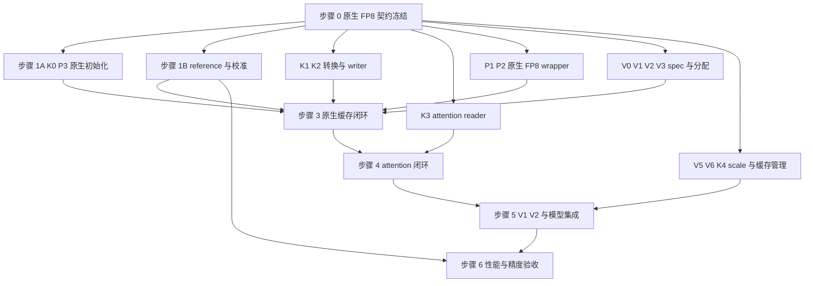

# FP8 KV Cache 适配设计

本方案在 W4A16 模型上使用 E4M3FN 保存 KV cache，attention 加载缓存后在片上反量化为 BF16，采用 BF16 矩阵乘输入、FP32 累加与 softmax，输出 BF16。第一版固定 head dimension 为 128、每页 256 个 token，覆盖普通 decoder MHA/GQA 的 prefill、prefix cache 命中、chunked prefill 和 decode。

算子实现所需的位定义、逐步量化/反量化、舍入测试向量和物理 word 例子见 [FP8 KV Cache 算子数值与布局契约](/Users/qingluo/fp8/vllm-cl/docs/fp8_kv_cache/kernel_numerics_and_layout.md)。

核心决策是使用两个 token 共用一个 512 B tile 的紧凑缓存，沿用 vLLM 的分页与 slot mapping 语义；新增的 FP8 算子由 PyTorch DLC 提供，vllm-cl 负责配置、元数据、缓存分配和生命周期。第一版 writer 按 KV head 分配唯一 XYS owner，顺序完成整 tile 读改写，避免依赖 HBM 字节原子写。

首版直接分配并持有 `torch.float8_e4m3fn` KV tensor，writer、reader 和整页 copy 的公开接口均接收这一 dtype。正式初始化路径使用补齐后的原生 FP8 `torch.zeros/zero_/fill_`；uint8 只可作为测试或底层原始字节操作的局部视图，不作为缓存的公开容器。两种一字节 dtype 的物理布局相同，双 token 的 512 B packing 保持不变。

日期：2026-10-14。状态：设计草案，接口名为拟新增接口。本文没有对应的已完成实现或真机验收结果。

| 仓库 | 本地设计基线 |
|---|---|
| vllm | `a07576686a` |
| vllm-cl | `d6e7a0b` |
| DLC_Custom_Kernel | `f880ba9f8` |
| pytorch | `2fd11d7d18` |

## 1 固定范围与配置

| 项目 | 第一版契约 |
|---|---|
| 权重 | 保留既有 W4A16 权重格式和 AWQ GEMM 路径 |
| 激活与 Q | BF16，禁止额外量化 Q |
| 新 K/V | BF16；K 已完成模型要求的 RoPE、归一化等变换 |
| 缓存编码 | E4M3FN，最大有限幅值 448 |
| 缓存容器 | `torch.float8_e4m3fn`，直接分配和绑定；不是 uint8 backing 外挂 FP8 视图 |
| 正式初始化 | `torch.zeros(shape, dtype=torch.float8_e4m3fn, device="dlc")`；补齐原生 fill 和 scalar 支持后启用 |
| attention 计算 | KV 解码和缩放用 FP32，舍入到 BF16 后参与矩阵乘；累加和 softmax 状态用 FP32 |
| 输出 | BF16；如输出 LSE，则为 FP32 |
| head dimension | K、V、Q 均为 `D=128` |
| page size | `P=256` 个 token；manager block 与 kernel block 均为 256，比例为 1 |
| head 数 | 使用当前 TP rank 的 `Hkv`、`Hq`，满足 `Hq % Hkv == 0` |
| scale | 每层 K/V 各一个固定、有限且大于零的 FP32 descale |
| 布局标识 | `dlc_fp8_e4m3fn_d128_p256_pair_v1` |
| 对外 KV 配置 | 第一版显式使用 `kv_cache_dtype="fp8_e4m3"` |
| query 能力声明 | `supports_quant_query_input=False` |
| 首版 attention 语义 | causal decoder full attention，无 ALiBi、softcap、sink、滑动窗口或跨层 KV 共享 |
| 并行范围 | 每 rank 独立缓存，可在此基础上验证 TP；不包含 DCP、PCP、PD 传输 |

MLA、稀疏 attention、KPool、SSM 状态、cross attention、其他 D/P、FP8 计算、per-head/per-token scale 和 speculative decoding 不属于第一版验收范围。碰到这些组合时，后端必须明确报不支持，不能忽略参数或把 FP8 buffer 交给 BF16 kernel。普通前缀缓存的共享只读块与必要的 copy-on-write 必须正确支持。

`dtype="bfloat16"` 与 KV dtype 分别控制模型激活和缓存。权重四位不要求缓存或 Q 也使用四位/八位计算。当前上游把 `fp8_e4m3` 默认映射为 `torch.uint8`，DLC backend 通过 `customize_spec` 把最终缓存 dtype 覆盖为 `torch.float8_e4m3fn`。不修改全局映射，也不应为此把平台的所有 FP8 compute 能力声明为 True。

## 2 官方依据与执行流程

官方 CUDA PagedAttention 已把 Q 的计算类型与 KV 的存储类型分开。当前 V1 Triton 的 `_cast_kv_tile` 在 Q 非 FP8 时执行 FP8 解码、FP32 乘 descale、转换到 Q dtype，再做 attention；这是本方案的数值依据。当前部分后端会自动量化 Q，所以必须由 DLC 后端显式关闭 `supports_quant_query_input`。[官方 CUDA 实现](https://github.com/vllm-project/vllm/blob/v0.10.0/csrc/attention/attention_kernels.cuh#L275)、[官方 Triton 实现](https://github.com/vllm-project/vllm/blob/main/vllm/v1/attention/ops/triton_unified_attention.py)、[官方 Attention 层](https://github.com/vllm-project/vllm/blob/main/vllm/model_executor/layers/attention/attention.py)。

```text
W4A16 QKV 投影
    -> BF16 Q/K/V
    -> 完成模型要求的 RoPE 等处理
    -> BF16 K/V 量化并写入 FP8 paged cache
    -> BF16 Q + FP8 paged cache
    -> tile 加载到 VMEM，解码与缩放，转 BF16
    -> BF16 QK / PV，FP32 softmax 与累加
    -> BF16 output
```

每层每步只写一次 cache。第一版沿用 vllm-cl 当前 `forward_includes_kv_cache_update=True` 的主路径，在 attention forward 中先 writer 后 reader。`do_kv_cache_update` 可以共享同一辅助函数，但不能又由 runner 在本次 forward 前重复执行。

同一当前 DLC stream 上的顺序为：必要的 clear/copy → cache writer → attention reader。不同 stream 之间必须建立运行时依赖；kernel 内的 `sync_device()` 只处理其规定的核心同步，不替代跨 stream 的依赖。

## 3 数值格式与 scale 生命周期

### 3.1 编码和反量化

以下 `sK`、`sV` 都表示反量化尺度，不是其倒数，也不是 attention 的 `softmax_scale`。

```text
K8 = E4M3FN_RNE(clamp(float32(Kbf16) / sK, -448, 448))
V8 = E4M3FN_RNE(clamp(float32(Vbf16) / sV, -448, 448))

Kcompute = BF16_RNE(E4M3FN_decode(K8) * sK)
Vcompute = BF16_RNE(E4M3FN_decode(V8) * sV)
```

RNE 表示最近偶数舍入。零保留符号，支持 E4M3FN subnormal；有限输入超出缩放后的范围时饱和到 ±448。若输入为 ±Inf，按同样饱和规则处理；NaN 编码统一为 `0x7f` 并在解码后保留 NaN。正常模型精度验收输入应为有限值，异常值行为另做格式测试。

上式的除法和乘法先舍入为 FP32，再分别做 FP8 RNE 和 BF16 RNE。不能提前把 scale 转成 BF16，也不能未经中点验证把 FP32 除法替换成近似 reciprocal 乘法；具体 reference 见算子数值与布局契约。

QK 的两个输入均为 BF16，积和以 FP32 累加。softmax 的指数、归一化及在线状态使用 FP32；进入 PV 矩阵乘前，把当前算法使用的概率 tile 舍入为 BF16，V 为反量化后的 BF16，输出累加器保持 FP32。独立 reference 应复现相同的舍入边界，不把“全程 FP32 attention”误当作逐位相同的参考。

缓存 tensor 的 dtype 直接声明 E4M3FN，kernel 仍按其编码位模式进行打包和解码。原生 dtype 不包含 KV scale，也不自动完成片上 BF16 转换。调试时 `.view(torch.uint8)` 是位重解释，`.to(torch.uint8)` 则是整数数值转换，二者不能替代。E4M3FN 与 FNUZ 不可混用。官方格式依据见 [ONNX FP8 规范](https://onnx.ai/onnx/technical/float8.html)，scale 方向见 [vLLM 转换器](https://github.com/vllm-project/vllm/blob/main/csrc/quantization/w8a8/fp8/nvidia/quant_utils.cuh)。

现有 `quant_e4m3_g128` 使用 group128 动态二次幂 scale 和 UE8M0 编码。新接口只复用其中的编码/解码原语，不能直接沿用其 scale 输入、输出布局或整个 main。现有 E4M3 编码函数遇到过大值可能生成 NaN，writer 必须在调用前执行上述 clamp。

### 3.2 参数来源

第一版采用独立的 KV scale 文件，避免要求重新打包 W4 权重。建议插件接收 `--additional-config` 中的 `dlc_fp8_kv` 配置；这是拟新增插件配置，不是当前已支持的命令。

```json
{
  "dlc_fp8_kv": {
    "layout": "dlc_fp8_e4m3fn_d128_p256_pair_v1",
    "scales_path": "/absolute/path/kv_scales.json",
    "allow_unit_scales": false
  }
}
```

scale 文件约定如下。示例中的尺度仅用于说明字段，不能作为模型校准值。

```json
{
  "schema_version": 1,
  "layout": "dlc_fp8_e4m3fn_d128_p256_pair_v1",
  "model_revision": "exact-model-or-checkpoint-identifier",
  "weight_quantization": "W4A16",
  "scale_convention": "dequant",
  "scale_scope": "layer_global",
  "layers": {
    "model.layers.0.self_attn.attn": {"k_scale": 0.03125, "v_scale": 0.015625}
  }
}
```

`layers` 的键必须与本次加载后的 Attention layer name 完全匹配，不能依赖示例名称。第一版每层在所有 TP rank 上使用相同的 K/V scalar scale；校准统计应覆盖所有 KV heads。加载时校验模型标识、布局、层覆盖、scope、数值有限性和正值。不允许部分层悄悄回退为 1。

`allow_unit_scales=true` 只用于显式的 bring-up/调试：缺少 scale 文件时统一使用 1 并记录日志，不把这个结果当作校准精度。常规验收使用校准文件。校准可以在布局和接口实现期间并行进行，使用实际 W4A16 路径产生的 K/V，覆盖目标长度和任务分布。`max(absmax/448, ε)` 可作为初始策略，再据模型精度评估调整。

### 3.3 加载和恢复顺序

1. 完成模型权重加载及所有 `process_weights_after_loading`，让上游默认 scale 初始化先结束。
2. 插件校验并加载 scale 文件，把规范值保存在 host 状态；同时更新 `_k_scale/_v_scale` 设备 buffer 以及仍被旧路径使用的 host mirror。
3. 完成 scale 安装后才允许 warmup、图捕获和正式 cache 写入。writer 和 reader 均使用相同的设备 FP32 scalar tensor，禁止在热路径 `.item()` 或重新构造常量。
4. 缓存有效期间 scale 不变。更换 scale、模型权重或编码协议时，必须使对应 KV cache 和 prefix cache 失效，再重新初始化；不能只替换 scale。
5. sleep/wake 若释放了缓存，则恢复校准尺度并使旧缓存失效；若完整保留缓存，则恢复完全相同的尺度。禁止继续使用当前 `init_fp8_kv_scales` 的强制置 1 行为。
6. 恢复时尽量原位更新 scale buffer。若其地址或缓存地址变化，按运行时规则重新捕获相关图。

scale 在逻辑上仅两个 FP32 数，但 DLC 可能对小 tensor 分别做 512 B 分配；内存统计应计入实际参数与工作区开销，不把“8 B”当作实际分配量。

## 4 缓存物理排布

### 4.1 形状与容量

符号统一如下：`N` 为物理块数，`H` 为本 rank 的 KV head 数，`P=256`，`D=128`，`j` 为页内 token pair 下标。

```text
cache dtype: torch.float8_e4m3fn
cache shape: [N, H, 128, 512]

每个 tile：2 个 token × 2 份 K/V × 128 元素 × 1 B = 512 B
每个 head/page：128 tiles × 512 B = 65,536 B
每个 page：H × 65,536 B
总 payload：N × H × 65,536 B
```

每层独立分配，`storage_offset=0`；最内层恰好 512 B，禁止按每个 token 的 256 B 行再次 padding。第一版拒绝任意 stride、非零 storage offset 和跨层共享 backing view。

| 布局，D128/P256 | 每 token/head 的真实 HBM 字节 |
|---|---:|
| 现有 BF16 merged | 512 |
| 同 merged shape 只改 FP8 dtype | 512 |
| 现有 FP8 separate shape，K/V 各自 padding | 1024 |
| 本方案 paired FP8 | 256 |

例如 N=1024、H=8：当前 BF16 merged payload 为 1 GiB，本方案为 512 MiB。该减半只针对 KV payload；不是整机显存或端到端吞吐翻倍的承诺。

### 4.2 逻辑元素与物理字节

DLC 的一个 E4M3FN tile 在 tensor 逻辑元素顺序中有四个 128 元素 plane；每个元素的数值是缩放后的 FP8 值：

```text
逻辑索引   0..127：K[2j,   0..127]
逻辑索引 128..255：V[2j,   0..127]
逻辑索引 256..383：K[2j+1, 0..127]
逻辑索引 384..511：V[2j+1, 0..127]
```

HBM 中则把四个 plane 打包进同一 lane 的 32-bit word。第 d 个 word 的位定义是：

```text
word[d] = K8[2j,d]
        | (V8[2j,d]   << 8)
        | (K8[2j+1,d] << 16)
        | (V8[2j+1,d] << 24)
```

公式中的 K8/V8 指 E4M3FN 编码字节；这些整数位操作在 kernel 内执行，不是对 FP8 tensor 调用整数算术。因此 CPU 逻辑数组的四段串接，不能直接当作原始 HBM 的连续 byte 顺序。现有 `store_u8_logical/store_fp8_group` 已使用相同 lane/shift 规则；测试必须分别验证逻辑 round-trip 和物理 word 位模式。

### 4.3 地址计算与 DMA 单位

对 `slot_mapping[i] >= 0`：

```text
b = slot_mapping[i] // 256
t = slot_mapping[i] % 256
j = t // 2
r = t % 2

tile_id = ((b * H + h) * 128 + j)
tile_byte_base = tile_id * 512

K_byte_offset = tile_byte_base + 4*d + 2*r
V_byte_offset = K_byte_offset + 1

head_stride_bytes  = 65,536
block_stride_bytes = H * 65,536
```

以上 byte offset 指真实 HBM；DLC kernel 的 `tensor` 地址以 128 B 为单位，实际指针为 `cache_base + tile_id * 4`。一次 tile DMA 长度为 **128 个 4 B word**，不是 512 个 word。地址乘法使用足够宽的中间值，并检查运行时地址范围，不能先在 int32 中计算大缓存的 byte offset。

历史读取仍按 `block_table[request, logical_token // 256]` 得到物理 block，页内 token 为 `logical_token % 256`。两个 token 打包不会改变 scheduler 的 token 位置、seq length、block table 或 slot mapping 单位。

### 4.4 vLLM spec 表达

使用上游已有的 AttentionSpec packing 字段，无需新增全局 dtype 或新 spec 类型：

```python
# 示意 customize_spec；仅对本方案且通过范围校验的 AttentionSpec 生效。
replace(
    spec,
    dtype=torch.float8_e4m3fn,
    num_head_slots=spec.num_kv_heads,
    tokens_per_state=2,
    state_content_bytes=512,
    page_size_padded=None,
)
```

保留 `block_size=256`、`head_size=head_size_v=128`、`kv_quant_mode=FP8_PER_TENSOR`。实际分配、绑定和 wrapper 校验以 customize 后的 spec.dtype 为准，不能再用全局字符串映射重新覆盖。普通 Attention 的 `kv_cache_torch_dtype` 当前主要用于生成原始 spec；本方案不要求修改其上游初始化，但插件后续读取必须使用最终 spec 或实际 tensor dtype。布局为 LBHNC，stored state 的数量是 128，token 数仍为 256。`customize_spec` 必须幂等，并拒绝冲突的既有 packing 或 page padding。

`page_size_bytes`、插件两个 padding/physical-page helper、`block_stride`、V1/V2 分配和 cache 管理必须统一返回 `H*65536`。插件不能再次按 BF16/FP32 的 head rounding 估算。本地 V2 已调用 `customize_spec`，V1 需要补齐相同调用；最终以 spec 和共享 layout helper 为单一几何来源。

### 4.5 原生 FP8 初始化

补齐支持后的正式分配路径固定为：

```python
cache = torch.zeros(
    (num_blocks, num_kv_heads, 128, 512),
    dtype=torch.float8_e4m3fn,
    device="dlc",
)
# runner 绑定和三个公开 KV 算子均直接使用 cache。
```

初始化结果的 dtype 为 `torch.float8_e4m3fn`，所有有效元素编码为正零 `0x00`；storage 独立、offset 为 0、实际 payload 为 `N*H*65536` B。不先分配 uint8 再 view 成 FP8，不在 runner 内因基础操作缺失自动切换容器，也不接受 CPU fallback 作为正式完成条件。

现有调用链为 `zeros → empty + zero_ → fill_(0)`。DLC fill 在 numel=1 时走 `custom_strided_set_scalar`，其他非空连续 tensor 走 `custom_full`。顶层 zeros/zero_ 接口已存在，必须补齐以下底层支持：

| 归属 | 必改位置 | 行为 |
|---|---|---|
| PyTorch P3 | `DLCKernelLaunch.h::_set_scalar_v` | 增加 Float8_e4m3fn，按 PyTorch FP8 scalar 转换取得编码 byte；不做普通整数 cast |
| kernel K0 | `factory/full.cpp::cal_hbm_len` | E4M3FN 使用 1 B 元素及 ALIGN512 行长 |
| kernel K0 | `factory/full.cpp::main` 的填充值分支 | 把编码 byte 复制到一个 word 的四个 byte，写满既定物理范围 |
| kernel K0 | `copy/strided_set_scalar.c::main` | 增加 E4M3FN 的单元素 byte RMW，保留相邻字节；无法支持的 dtype 明确诊断，不能静默不写 |

generic `fill_` 遵循 PyTorch scalar 转换语义，不使用 KV scale，也不继承 KV writer 的有限值饱和约定。例如 `fill_(1.0)` 应铺入 E4M3FN 编码 `0x38`，word 为 `0x38383838`，不是整数值 1 的字节复制；`zero_()` 写 `0x00000000`。scalar 编码在 host wrapper 完成不等于把整个 tensor 运到 CPU 计算，后者才属于本方案禁止的 fallback。

deterministic algorithms 开启时，`empty_dlc/empty_strided_dlc` 会经 `fill_empty_deterministic_` 先填 NaN；该 helper 已包含 FP8。因此必须支持 NaN fill（当前 quiet NaN 编码为 `0x7f`），不能只补“填 0”分支。正式验收包含 deterministic 开/关、rank-0、`[1]`、实际 cache shape、±0/1/448/NaN、四个 byte plane 的单元素 view 和相邻字节保护。允许通用 fill 的单元素 view 不等于允许公开 KV 算子接收非零 offset cache。

K0/P3 未完成时，可在独立 bring-up 中用直接分配的 FP8 tensor 加原始地址 zero helper 解除 writer/reader 的开发依赖；这种辅助路径不作为 runner 默认方案或验收替代。它也不能绕过 deterministic 模式下 empty 先填 NaN 的限制。最终真实分配与缓存闭环必须等待 K0/P3 的原生初始化验收。

## 5 算子接口

### 5.1 注册归属

新 FP8 路径统一使用 PyTorch 原生 `torch.dlc_*` 接口，PyTorch wrapper 校验契约并通过 KernelDesc 调用 kernel。vllm-cl 的 `_custom_ops.py` 增加薄封装和路由，避免在 PyTorch 与插件 C++ 中重复维护两套 FP8 kernel ABI。

现有 vllm-cl `csrc/cache.cpp`、`csrc/attention.cpp`、`csrc/torch_bindings.cpp` 的 BF16 接口保留。FP8 调用在 Python 适配层进入新接口，不再进入这些仅按输入 BF16 选择 kernel 的旧分支。可增加针对误调用的 dtype guard，但不以扩展旧 C++ 分支作为首版的核心实现方式。

下列签名是拟新增 Python 可调用接口；实际 schema 必须标注 mutation/alias，并提供可用于 fake/meta tracing 的等价定义。它们是推理算子，不要求 autograd。三个新接口均严格要求 cache dtype 为 `torch.float8_e4m3fn`；uint8、E5M2、FNUZ 直接报错，不做自动 cast。Tensor schema 本身不携带具体 dtype，校验必须落实到 wrapper 与 fake/meta 契约中。KernelDesc 直接传 FP8 tensor，arg.dtype 为 `DLC_FP8_E4M3_DTYPE`、arg.layout 为 1；kernel 按布局处理编码字节，不依赖“看见 FP8 dtype 就自动转换”。

### 5.2 量化写缓存

```python
torch.dlc_fp8_kv_cache_write_(
    self: Tensor,          # cache：float8_e4m3fn [N, H, 128, 512]，原位修改
    key: Tensor,           # BF16 [T, H, 128]
    value: Tensor,         # BF16 [T, H, 128]
    slot_mapping: Tensor,  # int64 [T]
    k_scale: Tensor,       # 设备 FP32 scalar，numel=1
    v_scale: Tensor,       # 设备 FP32 scalar，numel=1
) -> Tensor                # 返回同一个 cache，调用方可忽略
```

对应的 native schema 为 `dlc_fp8_kv_cache_write_(Tensor(a!) self, Tensor key, Tensor value, Tensor slot_mapping, Tensor k_scale, Tensor v_scale) -> Tensor(a!)`。cache 必须是第一个 `self` 参数，并返回相同 alias，以符合 torchgen 对原生 inplace 算子的约束。

本接口名称固定代表上述 layout v1、E4M3FN、D128/P256，不传含糊的 `kv_cache_merged` 布尔值。新增不兼容布局时新增 ABI 版本。所有张量在同一 DLC device，输入 K/V 允许既有 QKV view 由 wrapper 按明确 stride 读取或仅物化本轮 K/V；禁止隐式物化整个 cache。scale 支持标量或 `[1]` buffer。

`slot<0` 的输入行跳过，`0<=slot<N*256`；同次调用的非负 slot 必须唯一。T=0 或所有 slot 为负时为空操作。非唯一 slot 属于调用方错误，不定义 last-writer-wins。wrapper 校验 dtype/shape/设备；元数据生成器保证索引契约，device kernel 保留越界保护，开发模式提供索引异常诊断而不在正常热路径 D2H 同步。

cache 是唯一可变输入；不得与 K/V、scale 或 slot mapping alias。写入成功后只允许目标 token 的 K/V 字节改变，其他 token、head、block 完全保持。

### 5.3 分页 attention

```python
torch.dlc_fp8_kv_attention_out(
    query: Tensor,          # BF16 [Tq, Hq, 128]
    cache: Tensor,          # float8_e4m3fn [N, H, 128, 512]
    block_table: Tensor,    # int32 [R, max_blocks_per_request]
    seq_lens: Tensor,       # int32 [R]，本轮写入后的总 KV token 数
    cu_seqlens_q: Tensor,   # int32 [R+1]，只描述本轮 Q
    k_scale: Tensor,        # 与 writer 相同的设备 FP32 scalar
    v_scale: Tensor,
    max_seqlen_q: int,
    max_seqlen_k: int,
    softmax_scale: float,
    out: Tensor,            # BF16 [Tq, Hq, 128]，原位输出
    softmax_lse: Tensor | None = None,  # FP32 [Tq, Hq]，自然对数 LSE
) -> None
```

接口固定 causal full attention。第一版不接受并悄悄忽略 window、ALiBi、softcap、sink 等参数；插件在选择它前验证这些功能未启用。cache/scale/metadata 只读，out 与输入不得 alias。所有输出缓冲区由调用方提供，可复用地址以支持图捕获。

元数据语义如下：

```text
q_len[r] = cu_seqlens_q[r+1] - cu_seqlens_q[r]
prefix_len[r] = seq_lens[r] - q_len[r] >= 0
query_position = prefix_len[r] + local_query_index
可见 key：0 <= key_position <= query_position
GQA 对应 head：hkv = hq // (Hq/H)
```

有效请求满足 `q_len>=1`；空批次由 wrapper 直接返回。图捕获用 padding batch 时，inactive request 的 `q_len=seq_len=0` 必须跳过，padding Q 行输出为 0。不能以 local query index 直接构造前缀长度为零的三角 mask，否则 prefix hit 和 chunked prefill 会出错。

`cu_seqlens_q[0]=0` 且单调不减，最后一个值为有效 Q 数且不大于 Tq；max length 参数覆盖有效请求的实际最大值。每个有效请求需要的 block table 条目数为 `ceil(seq_len/256)`，条目位于 `[0,N)`。inactive/padding 行若请求 LSE，写为负无穷，避免全 mask softmax 产生 NaN。

只解引用有效范围内的 block table 条目。DMA 可以因 512 B 粒度带入同 tile 的无效另一 token，但在解码、softmax/PV 前必须屏蔽其内容；无效 V 置零，无效 score 置负无穷。不能依赖 `0*NaN` 消除未写 slot 的脏数据。

reader 将有效 FP8 tile 在 VMEM 中解码并乘 descale，转换成 BF16 后重组成现有 BF16 计算使用的 `K16 | (V16<<16)`，再进入 attention 主循环。不允许每步在 HBM 创建随总 cache 容量增长的 BF16 镜像。softmax/LSE 若内部使用 log2，需要在公开输出边界转换为自然对数。

### 5.4 缓存管理与校验接口

| 接口类别 | 第一版要求 | 归属 |
|---|---|---|
| block zero | 复用已有 `dlc_vllm_zero_block_ids_`，按相同 page bytes 分组；`page_size_el=H*65536/4` | 插件接入，PyTorch/kernel 验证复用条件 |
| block copy | 使用下述固定 schema 原始字节复制整页，不解码、不重新量化；支持 COW | 新 PyTorch 接口，kernel 可复用经验证的 byte DMA 实现 |
| swap/offload | 只有验证原始 byte 页和 scale 生命周期后才允许；第一版未接通的模式明确禁用 | 插件能力门禁及后续扩展 |
| gather/dequant | 提供测试辅助，将指定 block/slot 解码为 BF16 K/V；不作为默认 attention 前置步骤 | PyTorch/kernel 测试支持，可选生产接口 |
| reference encode/decode | 独立验证 E4M3FN 和物理 packing，不能把 writer 自身当作 golden | 测试工作包 |

首版 COW 所需的同设备、同层复制接口固定为：

```python
torch.dlc_fp8_kv_cache_copy_blocks_(
    self: Tensor,           # float8_e4m3fn [N,H,128,512]，原位修改目标页
    block_mapping: Tensor,  # DLC int64 [2,M]，第0行src，第1行dst
) -> Tensor                 # 返回相同 cache
```

native schema 为 `dlc_fp8_kv_cache_copy_blocks_(Tensor(a!) self, Tensor block_mapping) -> Tensor(a!)`。一次复制 `H*65536` 字节；M=0 或 src=dst 时为空操作。其余映射的 destination 必须唯一，source 与 destination 集合必须不相交，允许同一 source 复制到多个 destination；需要链式或重叠复制的调用方应分阶段或使用 scratch，不能把它当作本接口支持的并行操作。所有 block id 位于 `[0,N)`。输入 mapping 由插件提供，不做每步 D2H。

此接口仅覆盖同设备单层的 COW/页复制。插件为各层调用，跨设备和 host swap 仍由各自能力门禁控制。新页内容可清零，但正确的 reader masking 仍是必需条件。任何 copy、zero、回收都必须与 page 上的 RMW 和 attention 读取有序。

零块算子复用还需修正插件元数据入口：当前 `patch_kv_block_zeroer.py:init_meta_pytorch` 调用已移除的 `get_kv_cache_block_dim`。新布局直接从共享 helper 获取 `block_dim=0`、shape 和 page bytes，不走该 hook。统一 FP8 cache 不保证触发上游自动 zeroing，writer/reader 不得以“每次回收均已自动清零”为正确性前提。

## 6 writer 并发与缓存一致性

第一版不增加 slot→tile 分组算子，直接使用原始设备 slot mapping，保证 V1/V2 都能接入。不能假定 V1 的 CPU slot buffer 已经是本轮有效值，也不能为构造 tile 分组每步把 GPU metadata 拉回 CPU。

每个 KV head 的唯一 owner 为 `owner_xys=h%2`。各 XYS 顺序遍历有效输入行，仅更新自己拥有的 heads。对同一个 head，前一 token 的写回完成后才允许读取下一个 token 对应的 tile；所有并行 lane 只处理同一操作的不同 d。H=1 时 writer 只使用一个 XYS，另一个核心仍按 kernel 同步契约参与。

```text
for input_token in slot_mapping 顺序:
    for h in 本 XYS 拥有的 heads:
        读完整旧 tile 512 B，并等待 DMA 完成
        pair[d] = K8[d] | (V8[d] << 8)
        even: new_word[d] = (old_word[d] & 0xffff0000) | pair[d]
        odd:  new_word[d] = (old_word[d] & 0x0000ffff) | (pair[d] << 16)
        写完整 tile 512 B，并等待 DMA 完成
全部写回完成后执行规定的核心同步
```

这使一次调用内的 same-tile 两 token 更新有确定顺序，不受 slot 排序影响。禁止直接复制当前 BF16 writer 按输入 token 区间划分 XYS 的策略；不同核心的完整 tile RMW 会丢更新。多个 launch 更新同一 cache 也必须串行或建立依赖。

prefix cache 的共享块保持只读；向共享的部分页追加时，先由框架完成 COW，writer 只能写独占的目标块。slot 唯一不能代替 page 的可写所有权。

后续可按 tile 聚合成唯一更新记录，双 token 同时更新时省去旧 tile 读取，并按 tile 分配 XYS。该优化需要设备端 grouping 或可信的 CPU 元数据来源，必须保持上述 ABI 和结果语义；不作为首版正确性接通的依赖。基线 RMW 的单 token 写入会发生 512 B 读加 512 B 写，因此写缓存阶段的带宽不保证减半，主要预期收益来自容量和历史 KV 读取。

## 7 各仓库的实施工作

### 7.1 DLC Custom Kernel

| 工作包 | 修改或新增位置 | 具体工作 |
|---|---|---|
| K0 原生 FP8 fill | `dlc_kernels/factory/full.cpp`、`dlc_kernels/copy/strided_set_scalar.c` | 补齐 E4M3FN 的长度计算、编码 byte 铺写与单元素 RMW；支持 NaN 初始化；与 P3 对齐 scalar ABI |
| K1 数值与布局 helper | 新增 `dlc_kernels/kvcache/fp8_kv_pair_layout.h`；参考 `convert_element_type.h`、`quantization/fp8_g128/dequant_fp8_g128_bf16_common.h` | 明确 E4M3FN clamp/RNE、FP32 descale、BF16 rounding、word packing、地址单位；helper 为 inline |
| K2 writer | 新增 `dlc_kernels/kvcache/fp8_kv_cache_write.cpp`；参考 `reshape_and_cache_kv_bf16.cpp`、`indexer_k_quant_and_cache_bf16.cpp` | 接收 E4M3FN descriptor，按编码字节执行 head owner、完整 tile RMW、负 slot/边界处理和 DMA 完成顺序 |
| K3 attention reader | 新增 `dlc_kernels/attention/flash_attention/flash_attention_varlen_fp8kv_bf16.cpp`；复用现有 `flash_attention_varlen_kv_bf16.cpp` 计算结构 | 从原生 FP8 cache 按既定 word packing 加载，在片上解码并重建 BF16；接通 scale、prefix/chunked causal mask、GQA、LSE |
| K4 cache lifecycle | 审查 `dlc_kernels/vllm/zero_block_ids.cpp`；按需新增 `dlc_kernels/kvcache/fp8_kv_cache_copy_blocks.cpp` | 原生 FP8 页按原始字节清零/复制；zero 满足整页对齐可复用，不因 dtype 标签做数值转换 |
| K5 注册与验证 | `dlc_src/kernel_info.yaml` 或实际 dispatch 配置、`syntests/`、`pytorch_test/test_kernel/kvcache/` 和 attention 对应目录 | 为非标准命名源文件配置实际 kernel symbol；增加 packing、RMW、数值和 attention 测试；不手改生成代码 |

拟采用的 kernel symbols 为 `custom_fp8_kv_cache_write` 和 `custom_flash_attention_varlen_fp8kv_bf16`，在步骤 0 与 PyTorch wrapper 一起冻结。不要覆盖现有 BF16 symbols。硬件布局与并发限制在实现阶段同步记录到 kernel 仓库的 `doc/context.md`。

### 7.2 PyTorch DLC

| 工作包 | 修改或新增位置 | 具体工作 |
|---|---|---|
| P1 schema 与 wrapper | `aten/src/ATen/native/native_functions.yaml`；新增 `aten/src/ATen/native/dlc/fp8_kv_cache.cpp` 和 `fp8_kv_attention.cpp` | 注册 writer、reader、copy；cache 严格检查 Float8_e4m3fn；mutation/alias 与 fake/meta 一致，直接向 KernelDesc 传 FP8 tensor |
| P2 无隐式转换和复制 | 审查 `aten/src/ATen/dlc/DLCKernelLaunch.h`、`DLCTensorImpl.h`、`native/dlc/Copy_cpu.h` | 验证原生 FP8 `[N,H,128,512]` 可直接进入 kernel；同 dtype copy/CPU 往返无数值变化；不把整个 cache cast 或重排 |
| P3 原生初始化与分配 | 必改 `DLCKernelLaunch.h::_set_scalar_v`；联调 `native/dlc/TensorFactories.cpp`、`Fill.cpp`、`TensorFactories.h` 现有链路 | 与 K0 补齐 zeros/zero_/fill_ 和 deterministic NaN fill；证明实际分配 N*H*65536；无需重写 allocator 或已有 FP8 dtype mapping |
| P4 运行时与测试 | DLC 算子测试及构建源文件发现规则 | 当前 stream、非法 dtype、图捕获、空输入、output mutation、native FP8 gather/dump；确认新增 cpp 被构建系统收录 |

kernel ABI 的参数顺序由 schema、wrapper 和 kernel main 三方对照。scale 必须真正进入 kernel，不只是保留在 Python/C++ 签名中。`FusedOps.cpp` 中已有但未使用的 q/k/v descale 参数不能作为“已支持 FP8 KV”的依据；首版新路径不复用这个未接通的入口。

BF16↔E4M3FN 的通用 `.to()` 补全单独作为后续框架工作，不阻塞首版：writer/reader 自身已经完成融合转换，热路径不能调用缺失的通用 cast 而悄悄 CPU fallback。测试需要导出数值时，使用独立 reference、专用 gather/dequant 或先做同 dtype 的 D2H 搬运后在 CPU 转换，并单独标明测试路径。

### 7.3 vllm-cl

| 工作包 | 修改或新增位置 | 具体工作 |
|---|---|---|
| V0 平台配置 | `vllm_cl/platform.py` 的 `check_and_update_config` | 读取插件配置并验证首版范围；保持 `supports_fp8()` 的原有 compute 语义；布局由 layout id 和 packing 字段识别，不能只看 dtype |
| V1 布局与 spec | 新增 `vllm_cl/fp8_kv_cache_layout.py`；`vllm_cl/attention/attention.py` | 集中管理 layout id、D/P、shape/stride/page bytes；幂等 `customize_spec` 显式返回原生 FP8 dtype；声明 FP8 KV 支持并关闭 Q quant |
| V2 内存预算 | `patch/patch_kv_cache_interface.py`、`patch/patch_kv_cache_utils.py` | 对本 layout 使用 spec 的 page bytes；修正两个 padding helper、shape helper 和 block stride，避免再次按 head padding |
| V3 runner 分配 | `worker/dlc_model_runner.py`、`worker/dlc_model_runner_v2.py` | V1 补齐 customize_spec；V1/V2 按最终 spec 直接 torch.zeros(Float8_e4m3fn)；等待 K0/P3；绑定时检查 dtype/shape/offset；不把 pair 维误当 token block size |
| V4 算子路由 | `vllm_cl/_custom_ops.py`、`vllm_cl/attention/attention.py` | 新接口直接传原生 FP8 cache，拒绝 uint8 等错误 dtype；绕过旧拆分；传设备 scale；只写一次 cache；维护 BF16 out/FP32 LSE |
| V5 scale 生命周期 | 新增 `vllm_cl/fp8_kv_scales.py`；两个 runner 的 load/reload hook、`worker/dlc_worker.py` 的 wake 路径 | 校准文件加载、layer-name 校验、host/device mirror 一致；在默认 scale reset 后安装；恢复、失效和图重捕获 |
| V6 cache 管理 | `patch/patch_kv_block_zeroer.py`；在 `_custom_ops.py` 新增 copy 薄封装；`platform.py` 的 block transport hooks 与实际 COW 调用点 | 以 block 维 0、H*65536 B 复制/清零；校验 COW；暂未接通的 offload/connector 显式禁用 |
| V7 验证与诊断 | attention/cache 测试，V1/V2 集成测试和运行日志 | 输出每层最终 spec/tensor dtype、layout、scale 来源/page bytes；验证 native FP8 初始化无 fallback；拒绝不支持组合 |

旧 `get_kv_cache_shape` 在 FP8 下会选择 separate K/V，旧 C++ writer 则根据输入 BF16/D128 选择 merged BF16 kernel。新 FP8 分支必须同时替换两端，不能仅删除 `NotImplementedError`。`kv_cache_merged` 也不能再作为唯一布局标识。

`platform.py` 的 `insert_blocks_to_device/swap_out_blocks_to_host` 当前使用 `cache[:, block_indices]`，不适用于本方案 block 维为 0 的格式；不能让新缓存落入这个路径。第一版禁用未验证的 host transport；将来接通时，还须定义 host 端保存物理字节还是规范逻辑 plane，验证往返一致性，不能只把索引改成 `cache[block_indices]` 就宣称完成。

AWQ 权重代码不需要为缓存改变 packing。第一版采用加载后独立安装 KV scale，不要求修改 AWQ 的 `get_quant_method`。后续若统一改成 checkpoint 内加载，可以单独接入 BaseKVCacheMethod，但不得与 sidecar 同时产生两个相互覆盖的来源。

### 7.4 vllm 基线

当前基线已有 FP8 默认 dtype mapping、KVQuantMode、packing spec 字段和 backend hook。DLC 在 backend spec 中覆盖为原生 FP8 dtype，保留全局默认映射不变。第一版优先在插件和 DLC 运行时完成，不计划修改上游 vllm 的调度算法、权重量化格式、Attention 数值逻辑或全局 allocator。具体缺口是插件 V1 runner 尚未使用现有 customize_spec hook，应在插件中补齐。

## 8 实施步骤与并行关系

下表是依赖顺序，不是按天估时。步骤 1A、1B 和 2 均可在步骤 0 后启动；真实缓存联调必须等待原生初始化通过，不能用 uint8 替代分配掩盖这一依赖。

| 步骤 | 主责 | 工作与产物 | 前置依赖 | 可并行工作 | 退出条件 |
|---|---|---|---|---|---|
| 0 冻结契约 | kernel、PyTorch、vllm-cl | 固定 native FP8 dtype、512 B 布局、writer/reader/copy schema、初始化语义、scale 文件和测试样本 | 无 | 校准数据准备 | 三方使用同一 dtype、物理 word、地址单位和 symbols；generic fill 与 KV saturation 语义分开 |
| 1A 补齐原生初始化 | kernel K0、PyTorch P3 | scalar 编码、full 两处分支、单元素写入、zeros/zero_/fill_ 和 deterministic NaN fill | 步骤 0 | 1B、K1/K2、K3、P1/P2、V0/V1/V2/V3/V5 | 原生 FP8 cache 直接分配清零成功；无 CPU fallback、无 uint8 替代容器；单元素相邻字节保持 |
| 1B 建立参考与参数 | 测试、模型适配 | CPU E4M3FN/reference packing、BF16 round-trip、scale 校准文件、代表性用例 | 步骤 0 | 1A 与步骤 2 全部工作包 | 可独立生成 byte/数值 golden；scale 对齐实际模型 layer name |
| 2 并行开发核心能力 | kernel、PyTorch、vllm-cl | K1/K2 writer、K3 reader；P1/P2 native FP8 wrapper；V0/V1/V2/V3 几何和 V5 scale | 步骤 0 | writer 与 reader 用共同 golden 并行；fake/meta 和 spec 数学测试不等待硬件 kernel | 各工作包契约一致；fake/meta 或临时 bring-up 结果不等于原生初始化验收 |
| 3 接通原生 FP8 缓存 | kernel、PyTorch、vllm-cl | 正式 zeros(FP8) → writer → dump/gather → reference；检查真实分配、RMW、双 XYS | 步骤 1A、1B；K1/K2、P1/P2/P3、V1/V2/V3 | K3 reader 完成；K4/V6 copy/zero；模型校准 | cache 从分配、绑定到 writer 全程为 Float8_e4m3fn；byte/RMW 精确匹配，容量与预算一致 |
| 4 接通统一 attention | kernel、PyTorch、vllm-cl | K3+P1 与 V4 路由，prefill/decode/prefix/chunked 覆盖 | 步骤 3；K3 | V5 恢复测试、K4/V6 COW/zero；性能用例准备 | reader 直接接受 native FP8 cache，内部转 BF16；与量化后 BF16 reference 一致 |
| 5 完成运行时集成 | vllm-cl、测试 | V1/V2、W4A16 真模型、prefix/COW、reload、sleep/wake、图捕获 | 步骤 4；V5/V6 | 不同 runner、模型和确定性模式测试并行 | spec/tensor dtype 不回退为 uint8；恢复与初始化无 fallback；变化后正确失效或重捕获 |
| 6 性能与精度验收 | 三方、模型适配 | 固定预算容量、固定工作量延迟、长上下文精度、TP 和长时间运行 | 步骤 5；校准文件 | 性能与模型质量评估并行 | 满足第 9 节；报告实际收益与限制，再决定 tile grouping 等优化 |



协作时先划分文件所有权：K0 的通用 fill 与 K2 writer、K3 reader 分文件并行，数值/布局 helper 由 K1 维护。PyTorch 的 native_functions.yaml 由 P1 统一集成，DLCKernelLaunch.h 的 P3 scalar 改动与 P2 wrapper 审查由同一集成负责人协调。vllm-cl 的 attention.py 由 V1/V4 同一负责人串行合入，scale helper 与 geometry helper 可并行；两个 runner 的分配和加载 hook 最后统一集成。原生初始化是步骤 3 的硬依赖，不是所有源码开发的串行起点。

## 9 验收要求

### 9.1 分层参考

使用两条不同的比较链，区分实现错误与 FP8 本身的损失：

1. **算子正确性**：独立 encode → decode×scale → BF16 K/V → BF16 attention reference，与新 reader 输出比较。此处参考也包含同样的 FP8 误差。
2. **模型质量**：原 W4A16+BF16 KV 与 W4A16+FP8 KV 使用相同模型、输入和采样配置，比较困惑度/任务指标、长上下文检索和输出稳定性。不能要求有损 FP8 与原 BF16 输出逐位相同。

### 9.2 必测项目

| 层级 | 用例 | 要求 |
|---|---|---|
| 原生初始化 | 实际 FP8 cache shape、rank-0、`[1]`、零元素；zeros/zero_/fill_；±0/1/448/NaN；deterministic 开/关 | dtype 始终为 Float8_e4m3fn；generic fill 对齐 PyTorch CPU scalar 编码；zero 位模式为正零；无 CPU fallback、无 uint8 替代分配 |
| 单元素写入 | 四个 byte plane 内及边界的 scalar tensor/view fill | 只改变目标 byte，相邻元素保持；NaN 和非零值不能只走清零特例 |
| dtype 贯通 | V1/V2 customize 后 spec、真实分配/绑定、writer/reader/copy 实参、fake/meta 和 graph replay | 全链路原生 E4M3FN；错误 uint8/E5M2/FNUZ cache 明确拒绝；不按 module 初始默认 dtype 重新分配 |
| 编码 | ±0、subnormal、舍入中点、±448、溢出、Inf/NaN；K/V 使用不同且非 1 的尺度 | 约定编码与 packing bit-exact；NaN 采用规范编码 |
| 布局 | 首末 block/head/tile/d；slot 0/1/254/255/256；大缓存偏移 | 地址正确，无越界，逻辑与物理 round-trip 一致；包含大于 2 GiB 的地址算术验证 |
| RMW | even-only、odd-only、同 tile 两 token、shuffled slots、H=1/H>1、双 XYS | 未更新 half、相邻 head/block 逐字节不变；逐 token 写与完整两 token 构造结果一致 |
| masking | 无效另一 half 预填 NaN 字节；长度 1/255/256/257；无效 block table 尾部 | 无效内容不进入解码/累加；有效输出不被污染 |
| attention | MHA/GQA，多请求、多 Q 长度、prefix hit、跨页 chunked prefill、decode | 与量化后 BF16 reference 比较；沿用现有 BF16 kernel 的数值容差并记录最大误差与 RMSE |
| 功能门禁 | 不支持 D/P、window、ALiBi、softcap、MLA、DCP/PCP 等 | 初始化时拒绝，不运行错误 kernel |
| 分配与搬运 | 同 N/H 下 BF16 与新 FP8；同 dtype copy、CPU 往返；反复 reader/writer | payload 为 N*H*65536，FP8 编码不变，无 O(total cache) BF16 scratch，无隐式 cache cast/contiguous copy |
| 管理 | zero、copy/COW、block 回收、prefix 复用、不同 scale 文件 | 原始页 bit-exact；不跨 scale/model/layout 复用缓存 |
| 运行时 | V1/V2、空批次、图捕获/重放、reload、sleep/wake、TP | metadata/scale 地址和数值一致；变化后正确失效或重捕获 |

已有 BF16 数值容差若不覆盖新增测试形状，应在步骤 0 用现有 BF16 kernel 对同一 reference 确定基线，不允许仅为了让 FP8 实现通过而放宽。模型质量的业务容差依赖目标模型与任务，由模型适配负责人在步骤 0 登记；目前未指定目标模型，本文不虚设统一的质量百分点门槛。

容量验收固定 N/H，对比实际 allocator bytes；性能验收同时报告固定请求工作量的 prefill/decode 延迟与固定显存预算下的可容纳 token/吞吐，避免把增加并发带来的收益误写成单请求加速。记录 writer RMW、reader 解码、metadata、copy 和 scratch 的独立开销。首版 H=1 writer 单 XYS、整 tile RMW 是明确的性能边界。

## 10 关键风险与处理

| 风险 | 本方案的处理 |
|---|---|
| 原生 FP8 dtype 已映射但 zeros/fill 未接通 | K0/P3 同时补 scalar、行长、铺值和单元素分支；包含 deterministic NaN fill；作为步骤 3 前置验收 |
| 后端 spec 已改 FP8，runner 又按默认 uint8 分配 | 所有分配/绑定以幂等 customize 后的 spec 为准，并检查实际 tensor dtype；V1/V2 一致 |
| dtype 改小但 padding 未变 | 最内维固定 512 B，spec/allocator/stride 使用同一真实 page bytes |
| same-tile 并发写丢数据 | head 唯一 owner，slot 顺序 RMW，同 cache launch 有序；优化后仍保证 tile 唯一 owner |
| scale 方向或生命周期不一致 | 设备 scalar 为算子唯一输入；加载后安装、host mirror 同步、换 scale 使缓存失效 |
| 无效 half 或 token 污染 attention | 物理 DMA 可读整 tile，数值路径只使用有效 token，V 无效部分置零 |
| wrapper 重排整份 cache | 直接传正确形状的独立 storage；测试实际分配和 trace；拒绝不支持 view |
| 部分接口看似支持 FP8 | 新路径绕过旧 BF16 writer/reader；用非 1 scale 和真实 FP8 bytes 验证到底层 |
| 配置相同但格式不兼容 | 明确 layout id 与 ABI version；外部 cache/offload 未验证时禁用 |
| 收益被转换或 RMW 开销抵消 | 分离容量与延迟评估，先完成正确性，再对热点做 tile grouping 和流水优化 |
| 原生 FP8 通用 cast 进入 CPU fallback | 生产 KV 路径只用融合 writer/reader；通用转换补全独立排期，测试导出路径单独标识 |

## 11 源码定位

以下链接对应本地设计基线；实施时若版本变化，按符号重新定位。

| 主题 | 依据 |
|---|---|
| 官方读取反量化 | [本地 _cast_kv_tile](/Users/qingluo/fp8/vllm/vllm/v1/attention/ops/triton_unified_attention.py:39) |
| Q 自动量化条件 | [Attention query_quant](/Users/qingluo/fp8/vllm/vllm/model_executor/layers/attention/attention.py:462) |
| FP8 容器 dtype | [STR_DTYPE_TO_TORCH_DTYPE](/Users/qingluo/fp8/vllm/vllm/utils/torch_utils.py:35) |
| packing spec | [AttentionSpec](/Users/qingluo/fp8/vllm/vllm/v1/kv_cache_interface.py:386) |
| DLC 真实 HBM 对齐 | [DLCStorageImpl](/Users/qingluo/fp8/pytorch/aten/src/ATen/dlc/DLCStorageImpl.h:200) |
| KernelDesc contiguous 转换 | [DLCKernelLaunch](/Users/qingluo/fp8/pytorch/aten/src/ATen/dlc/DLCKernelLaunch.h:1045) |
| BF16 merged packing | [reshape_and_cache_kv_bf16](/Users/qingluo/fp8/DLC_Custom_Kernel/dlc_kernels/kvcache/reshape_and_cache_kv_bf16.cpp:3) |
| uint8 plane packing | [store_u8_logical 和 store_fp8_group](/Users/qingluo/fp8/DLC_Custom_Kernel/dlc_kernels/kvcache/indexer_k_quant_and_cache_bf16.cpp:67) |
| FP8 group 量化 | [quant_e4m3_g128](/Users/qingluo/fp8/DLC_Custom_Kernel/dlc_kernels/quantization/fp8_g128/quant_e4m3_g128.cpp:29) |
| FP8 解码 | [dequant_fp8_g128_bf16_common](/Users/qingluo/fp8/DLC_Custom_Kernel/dlc_kernels/quantization/fp8_g128/dequant_fp8_g128_bf16_common.h:21) |
| DMA 地址与长度单位 | [stdlen.h](/Users/qingluo/fp8/DLC_Custom_Kernel/dlc_kernels/stdlen.h:4)、[hhp_dma.h](/Users/qingluo/fp8/DLC_Custom_Kernel/dlc_kernels/ops/hhp_dma.h:58) |
| 现有 attention 主 kernel | [flash_attention_varlen_kv_bf16](/Users/qingluo/fp8/DLC_Custom_Kernel/dlc_kernels/attention/flash_attention/flash_attention_varlen_kv_bf16.cpp) |
| PyTorch 现有量化注册 | [native_functions.yaml](/Users/qingluo/fp8/pytorch/aten/src/ATen/native/native_functions.yaml:17092) |
| 后端 shape 与拒绝 FP8 | [get_kv_cache_shape](/Users/qingluo/fp8/vllm-cl/vllm_cl/attention/attention.py:112)、[量化限制](/Users/qingluo/fp8/vllm-cl/vllm_cl/attention/attention.py:276) |
| 当前主 attention 调用 | [flash_attn_varlen_func_dlc 调用](/Users/qingluo/fp8/vllm-cl/vllm_cl/attention/attention.py:390) |
| 旧 C++ writer | [cache.cpp](/Users/qingluo/fp8/vllm-cl/csrc/cache.cpp:47) |
| 旧 C++ reader descale 未接通 | [attention.cpp](/Users/qingluo/fp8/vllm-cl/csrc/attention.cpp:227) |
| 真实页大小估算 | [patch_kv_cache_utils](/Users/qingluo/fp8/vllm-cl/vllm_cl/patch/patch_kv_cache_utils.py:195) |
| 另一处 padding 属性 | [patch_kv_cache_interface](/Users/qingluo/fp8/vllm-cl/vllm_cl/patch/patch_kv_cache_interface.py:19) |
| V1 分配及 spec | [V1 cache 分配](/Users/qingluo/fp8/vllm-cl/vllm_cl/worker/dlc_model_runner.py:7289)、[V1 get_kv_cache_spec](/Users/qingluo/fp8/vllm-cl/vllm_cl/worker/dlc_model_runner.py:7489) |
| V2 customize_spec | [V2 get_kv_cache_spec](/Users/qingluo/fp8/vllm-cl/vllm_cl/worker/dlc_model_runner_v2.py:187) |
| scale 恢复缺口 | [init_fp8_kv_scales](/Users/qingluo/fp8/vllm-cl/vllm_cl/worker/dlc_model_runner.py:1008) |
| 既有零块算子复用条件 | [KV cache zero blocks 说明](/Users/qingluo/fp8/vllm-cl/docs/glm5_flash/op_requests/18_dlc_kv_cache_zero_blocks.md) |
| 官方量化文档 | [Quantized KV Cache](https://docs.vllm.ai/en/latest/features/quantization/quantized_kvcache/) |

## 12 原生 FP8 支持范围与后续工作

### 12.1 容器与物理布局

本方案直接使用 torch.float8_e4m3fn 作为正式 cache 容器。uint8 与 E4M3FN 都是一个字节，DLC 的 get_dlc_layout 按 itemsize 选择相同 byte layout，所以更换容器不会改变第 4 节的 packing、容量、DMA 单位和 RMW 所有权。原生 FP8 的类型语义更明确，但它不自带 scale、不自动去除 padding，也不自动替换 kernel 中的解码指令。[DLCStorageImpl.h](/Users/qingluo/fp8/pytorch/aten/src/ATen/dlc/DLCStorageImpl.h:79)

KernelDesc 已能把 Float8_e4m3fn 映射为 DLC_FP8_E4M3_DTYPE；同 dtype D2D copy 和同 dtype CPU/DLC 搬运均有按 layout 处理的基础路径。这些已有能力需要在实际 cache shape 下验证，不要求另造 FP8 分配器。[KernelDesc](/Users/qingluo/fp8/pytorch/aten/src/ATen/dlc/DLCKernelLaunch.h:890)、[copy 派发](/Users/qingluo/fp8/pytorch/aten/src/ATen/dlc/DLCKernelLaunch.cpp:283)、[CPU layout](/Users/qingluo/fp8/pytorch/aten/src/ATen/native/dlc/Copy_cpu.h:191)

### 12.2 首版必须完成的支持

| 能力 | 现状 | 首版工作与完成条件 |
|---|---|---|
| dtype mapping、empty 分配和布局 | 已有 mapping，layout 与 1 B 元素匹配 | 验证 native FP8 shape、真实 HBM bytes、独立 storage 和 offset |
| scalar 编码 | _set_scalar_v 缺少 Float8 分支 | P3 加入 FP8 scalar 编码，遵循 PyTorch generic fill 语义 |
| 连续 fill | full.cpp 长度与铺值分支均缺 FP8 | K0 两处分支均补齐，编码 byte 复制到 word 四个 byte |
| 单元素 fill | strided_set_scalar 缺少 FP8 分支 | K0 补 byte RMW，保护其他 byte，非法类型不静默成功 |
| deterministic 初始化 | empty 的 helper 已对 FP8 请求填 NaN | K0/P3 支持 NaN scalar 与填充；开/关模式下 zeros 都成功且无 fallback |
| KV writer/reader/copy | 新算子尚待实现 | P1/K2/K3/K4 公开接口只接 native E4M3FN，设备执行不借助通用全缓存 cast |
| vLLM 最终 spec 和 runner | 全局字符串映射仍默认 uint8 | V1/V3 在 customize_spec 覆盖 dtype，两个 runner 按最终 spec 直接分配、绑定 |
| 图捕获与生命周期 | 需结合新路径验收 | 原生 FP8 tensor 地址与 scale 生命周期一致，无 dtype 回退或隐式全缓存复制 |

初始化调用链证据：[zero_](/Users/qingluo/fp8/pytorch/aten/src/ATen/native/Fill.cpp:155)、[fill_scalar_dlc](/Users/qingluo/fp8/pytorch/aten/src/ATen/native/dlc/TensorFactories.cpp:107)、[scalar 编码](/Users/qingluo/fp8/pytorch/aten/src/ATen/dlc/DLCKernelLaunch.h:839)、[full 行长](/Users/qingluo/fp8/DLC_Custom_Kernel/dlc_kernels/factory/full.cpp:17)、[full 铺值](/Users/qingluo/fp8/DLC_Custom_Kernel/dlc_kernels/factory/full.cpp:145)、[单元素写入](/Users/qingluo/fp8/DLC_Custom_Kernel/dlc_kernels/copy/strided_set_scalar.c:156)、[deterministic helper](/Users/qingluo/fp8/pytorch/aten/src/ATen/native/TensorFactories.h:104)。

### 12.3 不作为首版前置的通用转换

FP32→E4M3FN 已有设备分支；BF16→E4M3FN 的 16bit kernel 输出分支尚缺，E4M3FN→BF16/FP32 缺少设备源 dtype 派发并可能进入 CPU fallback。首版 writer/reader 在 kernel 内完成第 3 节的缩放与编码/解码，因此完整通用 .to() 支持可单独并行或后续推进，不列为步骤 3 的依赖。任何依赖这些通用转换的调试路径应明确在 CPU 执行，不能混入生产性能结果。[FP32→FP8](/Users/qingluo/fp8/DLC_Custom_Kernel/dlc_kernels/copy/convert_element_type_32bit.cpp:133)、[BF16 转换分支](/Users/qingluo/fp8/DLC_Custom_Kernel/dlc_kernels/copy/convert_element_type_16bit.cpp:277)、[源 dtype 派发](/Users/qingluo/fp8/pytorch/aten/src/ATen/dlc/DLCKernelLaunch.cpp:289)、[CPU fallback](/Users/qingluo/fp8/pytorch/aten/src/ATen/dlc/DLCKernelLaunch.h:703)

同样不要求为了本方案修改 indexer 的既有 uint8 专用 ABI。那是不同缓存格式；本方案新增自己的 native FP8 writer/reader。[indexer 类型检查](/Users/qingluo/fp8/pytorch/aten/src/ATen/native/dlc/indexer_k_quant_and_cache.cpp:27)

### 12.4 原始字节视图的边界

允许测试、bit-exact dump 或底层原始页管理局部使用 cache.view(torch.uint8)，因为同 itemsize 的 view 共享 storage，不做量化、重排或拷贝。cache 本体始终是直接分配的 E4M3FN tensor，runner 与公开 writer/reader/copy 仍传 FP8 tensor。不得把 uint8 backing 加 FP8 view 当成正式分配方案，也不得用 .to(torch.uint8) 代替位重解释。[view_dtype](/Users/qingluo/fp8/pytorch/aten/src/ATen/native/TensorConversions.cpp:804)

相同物理字节与融合 kernel 下，原生 FP8 与 uint8 标签本身不会改变 HBM 流量或软件解码指令。此次选择原生 FP8 是明确类型与接口契约；容量收益仍来自双 token 排布，延迟收益仍需按第 9 节在芯片上验证。
